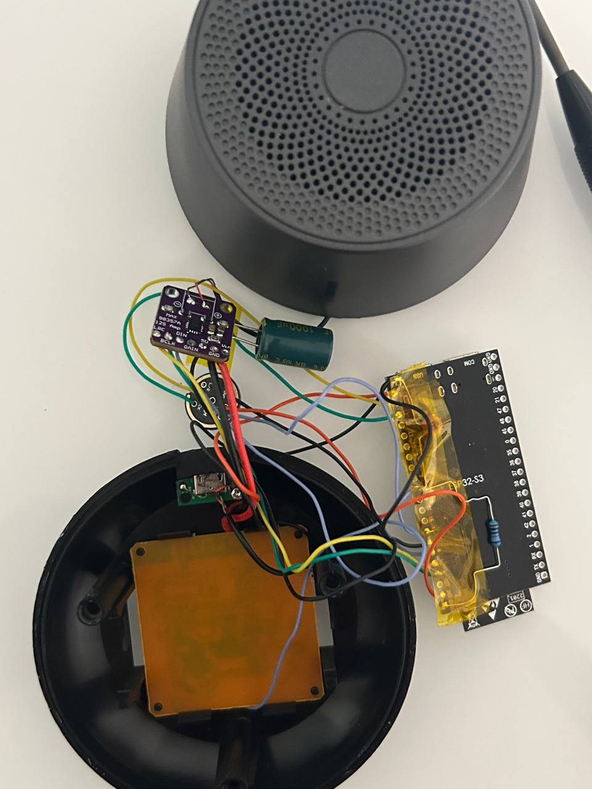

# Lenovo K3 PRO + Home Assistant

Перероблена китайська BT-колонка Lenovo K3 PRO у Wi-Fi колонку з голосовим асистентом для Home Assistant. Старий BT-чип і підсилювач випаяні, замість них ESP32-S3 + MAX98357A + мікрофон INMP441. Корпус, динамік, кнопки і USB-живлення лишились рідні.



## Що вміє

- media player в HA (музика, TTS, оголошення)
- "Okay Nabu" розпізнається на самій колонці, далі все робить Assist
- голосові таймери, слово "Stop" вимикає будильник і перериває довгу відповідь
- 5 рідних кнопок працюють і прилітають в HA як event-и (click / double / long)
- RGB-діод на ESP показує стан

Bluetooth після переробки не працює, ESP32-S3 не вміє BT Classic.

## Залізо

- плата `ZCY01(DXP)-V3.0` (на інших ревізіях не перевіряв)
- ESP32-S3 N16R8 (YD-ESP32-S3 / DevKitC-1)
- MAX98357A
- INMP441
- 100k, 100nF, 1000uF електроліт

Піни:

```
GPIO4  -> MAX98357A BCLK
GPIO5  -> MAX98357A LRC
GPIO6  -> MAX98357A DIN
GPIO7  -> MAX98357A SD
GPIO8  <- кнопки (пад 2 старого U1, 100k до 3V3, 100nF до GND)
GPIO13 -> INMP441 SCK
GPIO14 -> INMP441 WS
GPIO15 <- INMP441 SD
GPIO48    RGB діод на платі
```

## Прошивка

ESPHome, конфіг в `esphome/k3-pro-speaker.yaml`. Потрібен ESPHome 2026.8+.

Перед збіркою:
1. створи `secrets.yaml` з `wifi_ssid` і `wifi_password`
2. впиши свій ключ в `api.encryption.key`
3. `esphome run esphome/k3-pro-speaker.yaml`

Чутливість мікрофона, гучність і пороги кнопок винесені в `substitutions` на початку файлу.

## Home Assistant

Пристрій підхоплюється через ESPHome інтеграцію. Далі в налаштуваннях пристрою вибрати свій Assist пайплайн. Якщо відповідь довго "думає", постав **Finished speaking detection** на Aggressive.

В `homeassistant/k3_pro_automations.yaml` є приклад автоматизації: вимикає wake word на ніч.
